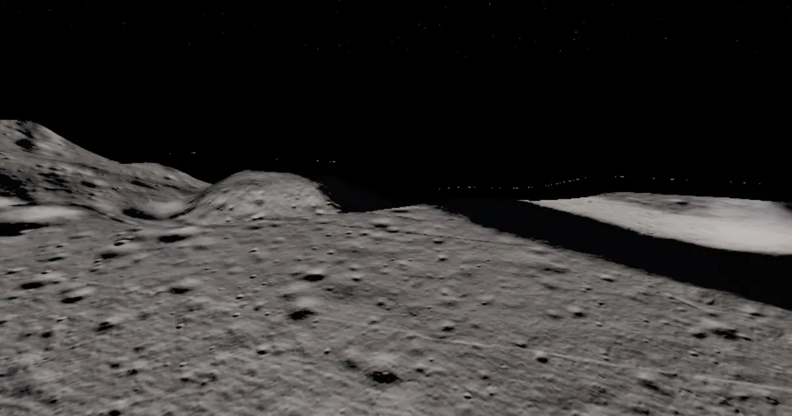

> **Evaluation status:** Automated functional and accessibility testing is complete. Agent-based design reviews and headed performance testing are in progress (see `STATUS.md`). No real learners have tested this yet. No physical phone testing has been done (mobile was checked with device emulation). See `evaluation/METHODS.md`.

# Lunar Field Expedition

A 50-minute hybrid course and field game for grade 9–12 earth and space science (and intro undergraduate geology). Land at the real Apollo 15 Hadley–Apennine site, rebuilt from NASA's LROC terrain data. Read the landscape under changing sunlight, compare the ages of surfaces, plan a sampling traverse, and defend your findings in a claim-evidence-reasoning field report that you then compare with what the Apollo 15 crew actually did.

**[Play now](https://immersive-learning-showcase.vercel.app/play/lunar-field-expedition/)** (live once v1.0.0 is pinned in the showcase) · **[Design documents](design/)** · Role: Sole designer

The mission framing (you're part of a future field team revisiting Hadley) is **fictional**. All geology and Apollo 15 history are real and cited in [research/apollo15-facts.md](research/apollo15-facts.md). The EVA cost model and the sample cards are **simplified for teaching** and labeled that way in the app.

## The problem

Arguing from evidence is a core science practice, but students rarely get to do it with real data about a place they can't visit. Planetary field geology is the extreme case: nobody can take a class to the Moon. Most "space" experiences are tours. This one is an inquiry task with a real geological question, real terrain, and an assessment of the argument, not of recall.

## Audience and context

- Grade 9–12 earth and space science; adaptable for intro undergraduate geology labs.
- 45–60 minutes in one or two sittings; progress is saved in the browser.
- Prior knowledge: a basic idea of erosion and deposition. No lunar geology needed.
- Standards (verified wording in the research log): NGSS HS-ESS1-6 and Science and Engineering Practice 7, argument from evidence.
- Personas and needs analysis: [design/personas.md](design/personas.md), [design/needs-analysis.md](design/needs-analysis.md).

## The five modules

| Module | Core question | Activity | Assessment |
|---|---|---|---|
| 1. Arrival | Where are we, and what's the question? | Optional captioned approach over the Apennine Front; the mission brief | Pre-check (5 items) |
| 2. Reading the landscape | What landforms are here? | Sun-angle tool and feature tagging in 3D; elevation profile across Hadley Rille | Tag 4 features with justification |
| 3. Which is older? | How can we tell relative age? | Crater counting on two equal-area patches (mare vs Front); superposition | Compare densities; explain the conclusion |
| 4. Field traverse | Where should we sample? | Plan a route under EVA time and consumables limits; visit stations; collect evidence | Traverse quality scored against criteria |
| 5. Field report | What do we conclude? | Build a CER report from the evidence board; compare with the real Apollo 15 traverse and the Genesis Rock story | Rubric self-check against an exemplar; post-check (5 items) |

## Key design decisions

| Decision | Alternatives | Rationale |
|---|---|---|
| Real LROC terrain (NAC_DTM_APOLLO15, 2 m/px) | Hand-modeled terrain | The landforms are the evidence. Relief was validated against published values ([evaluation/results/terrain-validation.json](evaluation/results/terrain-validation.json)). |
| No vertical exaggeration | Exaggerate for drama | Accuracy first |
| Let the crater counts "disagree" with the sample ages | Pick patches that give the expected answer | The Front patch has far fewer craters than the mare (about 14 vs 85 per km² in the computer count) because steep slopes erase craters. Module 3 makes that disagreement the lesson: crater counting only works on flat, stable surfaces. |
| Rubric self-check, no auto-grading of writing | Keyword scoring | Keyword scoring is unreliable and gives misleading feedback. The app checks that the required evidence *types* are cited and shows the rubric and an exemplar. |
| Compare with the real Apollo 15 traverse | Fictional ending | Connects the learner's reasoning to what working scientists did |
| No astronaut avatar; first-person view | Third-person avatar | Avoids extraneous detail and uncanny figures |

Full list with dates: [DECISIONS.md](DECISIONS.md).

## Realism and cinematics: design rationale

Realism is spent where it carries the content: terrain shape from the real DTM, real sun direction, and hard shadows, because low sun is what reveals relief. The regolith texture is medium detail; Earth and the stars are dimmed and only there for orientation; there are no avatars, dust particles or lens flares during tasks. This follows research showing realistic detail helps when it is task-relevant ([PMC study](https://pmc.ncbi.nlm.nih.gov/articles/PMC11269326/)) and that seductive details tend to hurt learning ([2025 meta-analysis](https://link.springer.com/content/pdf/10.1007/s10648-025-10099-z.pdf)).

Cinematic budget: three shots totaling 60 seconds (25 + 15 + 20), inside the 90-second budget. Each is captioned, skippable from the first frame, and has a reduced-motion version (still frames with the same captions). None plays during an assessment. See [design/realism-matrix.md](design/realism-matrix.md) and [design/shot-list.md](design/shot-list.md).

## Evidence and evaluation

**What was measured** (details in [evaluation/METHODS.md](evaluation/METHODS.md)):
- **Terrain accuracy:** rille depth at the site measured at 284 m from the DTM. Published values are about 370 m near the site and 180–270 m typical elsewhere, so that passes within the ±25% tolerance. Relief inside the play area is 932 m.
- **47 unit tests:** the browser PNG heightmap decoder against the real terrain assets; sun and traverse cost models; learning record, evidence board and state; content integrity, including the cinematic budget.
- **Browser tests:** a scripted playthrough of all five modules to the post-check; text-mode parity across all five modules; reduced-motion stills; header controls; an axe scan with zero critical or serious issues; the sub-path test at `/play/lunar-field-expedition/`.
- **Fact check:** every Apollo 15 claim is traced in the research log, with a verification status (VERIFIED, VERIFIED-SNIPPET or DERIVED).
- **Pending:** agent-based design reviews (including "high-school earth science teacher" and "planetary geologist" persona reviews), headed performance runs per preset, and the trailer.

**What it can show:** the course works end to end in 3D and in text mode, by keyboard; the terrain's relief matches published values; the facts trace to sources.

**What it can't show:** whether students write better arguments from evidence, or whether it fits real classrooms. No learners have used it.

## Play it your way

- **Text mode:** every module, with annotated orthoimages under high and low sun, elevation profiles as data tables, crater counts as a data task, the traverse as a station-choice list with costs, and the same CER builder.
- **Keyboard:** the sun sliders, profile presets, crater-counter controls (patch tabs, undo, submit, reveal) and route planning are native buttons, selects and sliders. Marking individual craters in 3D needs a pointer; the text-mode crater data task is the keyboard equivalent.
- **Reduced motion:** follows your system setting, with an in-app toggle; camera flights become still frames.
- **Quality presets:** Low, Medium, High and Ultra, chosen automatically and overridable in Settings.

## Accessibility

Tested with axe-core (WCAG 2.1 A/AA rules), scripted keyboard playthroughs and the Playwright accessibility tree. Guidepup/VoiceOver automation was not run (see `../SYSTEM-CHANGES.md`). Counting craters in 3D needs vision; the text-mode crater data task is the documented equivalent. No daily screen-reader user has reviewed it. Details: [design/accessibility-plan.md](design/accessibility-plan.md).

## System requirements and known limitations

- A current Chrome, Edge, Firefox or Safari with WebGL2. Without it, every objective is still available in text mode.
- Best on a desktop or laptop. Phones use the Low preset; checked with device emulation only.
- The play area is cropped: it contains the lower ~1 km of the Apennine Front, not its full ~4.6 km rise.
- Some station positions are approximate (read from NASA's traverse map) and labeled so in the app.

## Teacher guide

Timing, misconceptions (for example, "craters are volcanoes"), discussion prompts and an answer key: [design/teacher-guide.md](design/teacher-guide.md).

## Tools used

three.js 0.186.1, Vite 8.3.5, GDAL 3.13.3 for the terrain pipeline, Vitest, Playwright with axe-core. NASA LROC, LOLA and Apollo imagery (public domain). AI assistance: an AI coding agent wrote the code, content and documents under my direction. Facts were checked against the sources in the research log; design reviews are done by a separate agent and labeled as such.

## License and attribution

Code: MIT ([LICENSE](LICENSE)). Learning content: CC BY 4.0 ([LICENSE-CONTENT](LICENSE-CONTENT)). NASA data and imagery and other third-party assets: [ATTRIBUTION.md](ATTRIBUTION.md).
