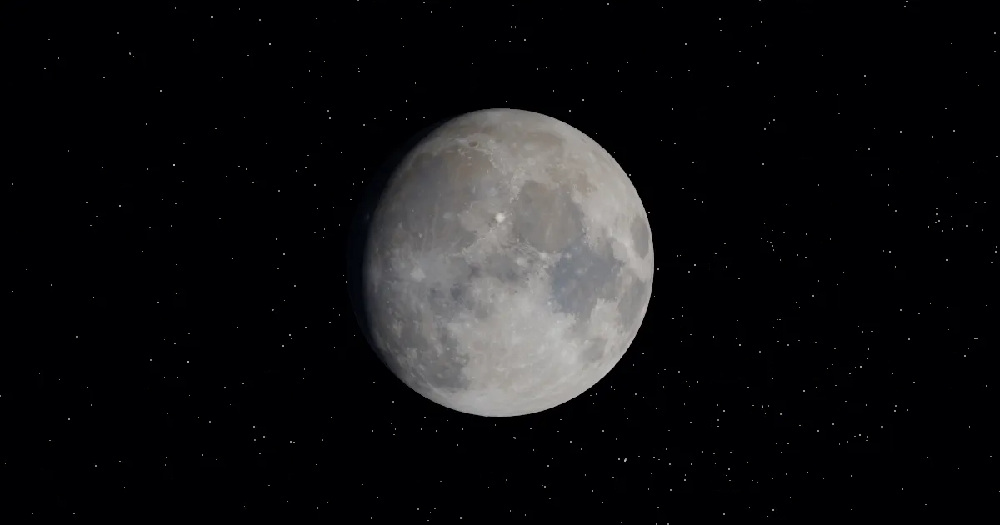

> **Evaluation status (v3.0.0, 2026-11-09):** Automated functional, accessibility and performance testing is complete, plus agent-based design reviews (three v3 passes, labelled Agent review). The owner reviewed the v3 scenes and approved them on 2026-11-09; that is owner visual approval, not user testing. No real learners have tested this yet. No physical phone testing has been done (mobile was checked with device emulation). Known open issues at v3.0.0 are listed in [STATUS.md](STATUS.md). See `evaluation/METHODS.md`.

# Lunar Field Expedition

A 50-minute hybrid course and field game for grade 9–12 earth and space science (and intro undergraduate geology). Land at the real Apollo 15 Hadley–Apennine site, rebuilt from NASA's LROC terrain data. Read the landscape under changing sunlight, compare the ages of surfaces, plan a sampling traverse, and defend your findings in a claim-evidence-reasoning field report that you then compare with what the Apollo 15 crew actually did.

**[Play now](https://immersive-learning-showcase.vercel.app/play/lunar-field-expedition/)** · **[Design documents](design/)** · Role: Sole designer

The mission framing (you're part of a future field team revisiting Hadley) is **fictional**. All geology and Apollo 15 history are real and cited in [research/apollo15-facts.md](research/apollo15-facts.md). The EVA cost model and the sample cards are **simplified for teaching** and labeled that way in the app.

## The problem

Arguing from evidence is a core science practice, but students rarely get to do it with real data about a place they can't visit. Planetary field geology is the extreme case: nobody can take a class to the Moon. Most "space" experiences are tours. This one is an inquiry task with a real geological question, real terrain, and an assessment of the argument, not of recall.

## Audience and context

- Grade 9–12 earth and space science; adaptable for intro undergraduate geology labs.
- 45–60 minutes in one or two sittings; progress is saved in the browser.
- Prior knowledge: a basic idea of erosion and deposition. No lunar geology needed.
- Standards (verified wording in the research log): NGSS HS-ESS1-6 and Science and Engineering Practice 7, argument from evidence.
- Personas and needs analysis: [design/personas.md](design/personas.md), [design/needs-analysis.md](design/needs-analysis.md).

## The five modules

| Module | Core question | Activity | Assessment |
|---|---|---|---|
| 1. Arrival | Where are we, and what's the question? | Optional captioned approach over the Apennine Front; the mission brief | Pre-check (5 items) |
| 2. Reading the landscape | What landforms are here? | Sun-angle tool and feature tagging in 3D; elevation profile across Hadley Rille | Tag 4 features with justification |
| 3. Which is older? | How can we tell relative age? | Crater counting on two equal-area patches (mare vs Front); superposition | Compare densities; explain the conclusion |
| 4. Field traverse | Where should we sample? | Plan a route under EVA time and consumables limits; visit stations; collect evidence | Traverse quality scored against criteria |
| 5. Field report | What do we conclude? | Build a CER report from the evidence board; compare with the real Apollo 15 traverse and the Genesis Rock story | Rubric self-check against an exemplar; post-check (5 items) |

## Key design decisions

| Decision | Alternatives | Rationale |
|---|---|---|
| Real LROC terrain (NAC_DTM_APOLLO15, 2 m/px) | Hand-modeled terrain | The landforms are the evidence. Relief was validated against published values ([evaluation/results/terrain-validation.json](evaluation/results/terrain-validation.json)). |
| No vertical exaggeration | Exaggerate for drama | Accuracy first |
| Let the crater counts "disagree" with the sample ages | Pick patches that give the expected answer | The Front patch has far fewer craters than the mare (none of 80 m or more against about 28 per km² in the computer count) because steep slopes erase craters. Module 3 makes that disagreement the lesson: crater counting only works on flat, stable surfaces. |
| Rubric self-check, no auto-grading of writing | Keyword scoring | Keyword scoring is unreliable and gives misleading feedback. The app checks that the required evidence *types* are cited and shows the rubric and an exemplar. |
| Compare with the real Apollo 15 traverse | Fictional ending | Connects the learner's reasoning to what working scientists did |
| First-person view; two suited crew figures in the scene (since v2.0.0, rebuilt in v3 with foot contact on the terrain) | Third-person avatar | The learner stays first-person. The crew are the fictional future-mission team, labelled as such, and calm down during tasks |
| v2 living layer on top of the real terrain (boulders, LM, rover, flag, crew) | Re-sculpt the terrain | The DTM is the evidence and stays untouched; close-range detail is separate geometry grounded on it |

Full list with dates: [DECISIONS.md](DECISIONS.md).

## Realism and cinematics: design rationale

Realism is spent where it carries the content: terrain shape from the real DTM, real sun direction, and hard shadows, because low sun is what reveals relief. The regolith texture is medium detail; Earth and the stars are dimmed and only there for orientation; since v2.0.0 a living layer sits on top: Poly Haven CC0 boulders, a procedural Lunar Module descent stage, rover and flag, and two suited crew. Ambient motion (Earth turning, rover dust, crew walking) slows to about 30 % during module tasks and stops with reduced motion; there are no lens flares, no fog and no star twinkle (no atmosphere). Art direction: [design/art-bible.md](design/art-bible.md). This follows research showing realistic detail helps when it is task-relevant ([PMC study](https://pmc.ncbi.nlm.nih.gov/articles/PMC11269326/)) and that seductive details tend to hurt learning ([2025 meta-analysis](https://link.springer.com/content/pdf/10.1007/s10648-025-10099-z.pdf)).

Cinematic budget: three shots totaling 60 seconds (25 + 15 + 20), inside the 90-second budget. Each is captioned, skippable from the first frame, and has a reduced-motion version (still frames with the same captions). None plays during an assessment. See [design/realism-matrix.md](design/realism-matrix.md) and [design/shot-list.md](design/shot-list.md).

## Evidence and evaluation

**What was measured** (details in [evaluation/METHODS.md](evaluation/METHODS.md)):
- **Terrain accuracy:** rille depth at the site measured at 284 m from the DTM. Published values are about 370 m near the site and 180–270 m typical elsewhere, so that passes within the ±25% tolerance. Relief inside the play area is 932 m.
- **168 unit tests** (v3.0.0): the browser PNG heightmap decoder against the real terrain assets; sun and traverse cost models; crater relief against patch noise; every Now-card step has an action and fits the word limit; astronaut foot contact; learning record, evidence board and state; content integrity, including the cinematic budget.
- **15 browser tests** (v3.0.0): keyboard-only completion of all five modules; text-mode parity; reduced motion; card hold; touch tap; no-WebGL2 fallback; Back and Back to start; an axe scan with zero critical or serious issues; the sub-path test at `/play/lunar-field-expedition/`.
- **Fact check:** every Apollo 15 claim is traced in the research log, with a verification status (VERIFIED, VERIFIED-SNIPPET or DERIVED).
- **Performance (v3.0.0, headed Chromium on an Apple M1 GPU, Medium, ui-audit at 1440×900, 1280×720, 390×844 and 844×390 in every module state):** GPU time at most 10.47 ms at p95 (budget 12 ms), at most 302 draw calls and 1.44 M triangles, 2.96 MB downloaded before the first interaction; the rest of the terrain streams after the first click. Two cells sat at their limits in the full run (Module 1 cinematic 46 fps at 1440×900; the sky view 302 draw calls at 844×390) and passed on a re-run. Report: `evaluation/results/ui-audit-g2-verify.json`.
- Agent-based design reviews are complete (see `evaluation/reviews/` and the v3 review passes); the revisions they produced are in `DECISIONS.md`.

**What it can show:** the course works end to end in 3D and in text mode, by keyboard; the terrain's relief matches published values; the facts trace to sources.

**What it can't show:** whether students write better arguments from evidence, or whether it fits real classrooms. No learners have used it.

## Play it your way

- **Text mode:** every module, with annotated orthoimages under high and low sun, elevation profiles as data tables, crater counts as a data task, the traverse as a station-choice list with costs, and the same CER builder.
- **Keyboard:** all five modules can be finished with the keyboard alone (a browser test does it): the Now card, the Sun slider, the landform letters, the profile presets, the crater counter, the planner, the report and the checks are native buttons, sliders, selects and fields. The menu's "Objects in view" list reaches every object; Enter opens its card. Marking individual craters in 3D needs a pointer; the text-mode crater data task is the keyboard equivalent.
- **Navigation (v3):** one top bar with the module steps, **Back** (the previous screen) and **Back to start** (the intro). Project pages don't link to other projects.
- **Explore (v3):** drag to look, W A S D or the arrow keys to walk, the wheel to zoom, double-click the ground to fly there; on touch, the joystick and the camera buttons. Click or tap a course object (for example the rille, the craters, the landforms or the Genesis Rock) to learn what it is; every find goes into the discovery journal. Decorative objects such as the flag, the ALSEP instruments, Earth and the stars don't open cards. Hold Alt or L to show every label; `?` shows the controls and the legend.
- **Reduced motion:** follows your system setting, with an in-app toggle; camera flights become still frames.
- **Quality presets:** Low, Medium, High and Ultra, chosen automatically and overridable in Settings.

## Accessibility

Tested with axe-core (WCAG 2.1 A/AA rules), scripted keyboard playthroughs and the Playwright accessibility tree. Guidepup/VoiceOver automation was not run (see `../SYSTEM-CHANGES.md`). Counting craters in 3D needs vision; the text-mode crater data task is the documented equivalent. No daily screen-reader user has reviewed it. Details: [design/accessibility-plan.md](design/accessibility-plan.md).

## System requirements and known limitations

- A current Chrome, Edge, Firefox or Safari with WebGL2. Without it, every objective is still available in text mode.
- Best on a desktop or laptop. Phones use the Low preset; checked with device emulation only.
- From v3 the whole ~4.6 km Apennine Front, Mons Hadley and Hadley Delta stream in as 3D Tiles after the first click (NAC 5 m near the site, SLDEM2015 80 m farther out). The tools (profiles, crater patches, traverse costs) still read the 10 m v2 heightfield inside the original play area.
- Sped-up or simplified motion is labelled on the object's card: the Sun and Earth move in time-lapse, the orbiter's pass is time-compressed, the micrometeoroid flashes' frequency is illustrative.
- Some station positions are approximate (read from NASA's traverse map) and labeled so in the app.

## Teacher guide

Timing, misconceptions (for example, "craters are volcanoes"), discussion prompts and an answer key: [design/teacher-guide.md](design/teacher-guide.md).

## Tools used

three.js 0.186.1, 3d-tiles-renderer 0.5.3, postprocessing 6.39.5, Vite 8.3.5, GDAL 3.13.3 for the terrain pipeline, Vitest, Playwright with axe-core. NASA LROC, LOLA and Apollo imagery (public domain). AI assistance: an AI coding agent wrote the code, content and documents under my direction. Facts were checked against the sources in the research log; design reviews are done by a separate agent and labeled as such.

## License and attribution

Code: MIT ([LICENSE](LICENSE)). Learning content: CC BY 4.0 ([LICENSE-CONTENT](LICENSE-CONTENT)). NASA data and imagery and other third-party assets: [ATTRIBUTION.md](ATTRIBUTION.md).

## Trailer

**Trailer:** [docs/trailer.webm](docs/trailer.webm) (57 s, recorded from v2.0.0 including the living site, so it doesn't show the v3 scene; captioned; WebVTT sidecar at [docs/trailer.vtt](docs/trailer.vtt)). Recorded from the real app on the Mac GPU; the caption text is also in the sidecar file.
